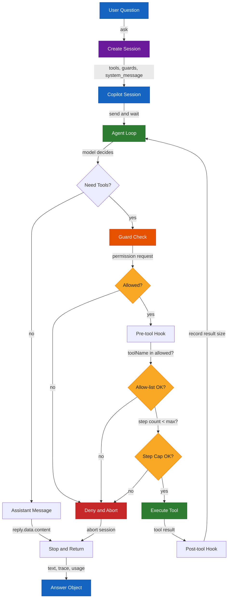
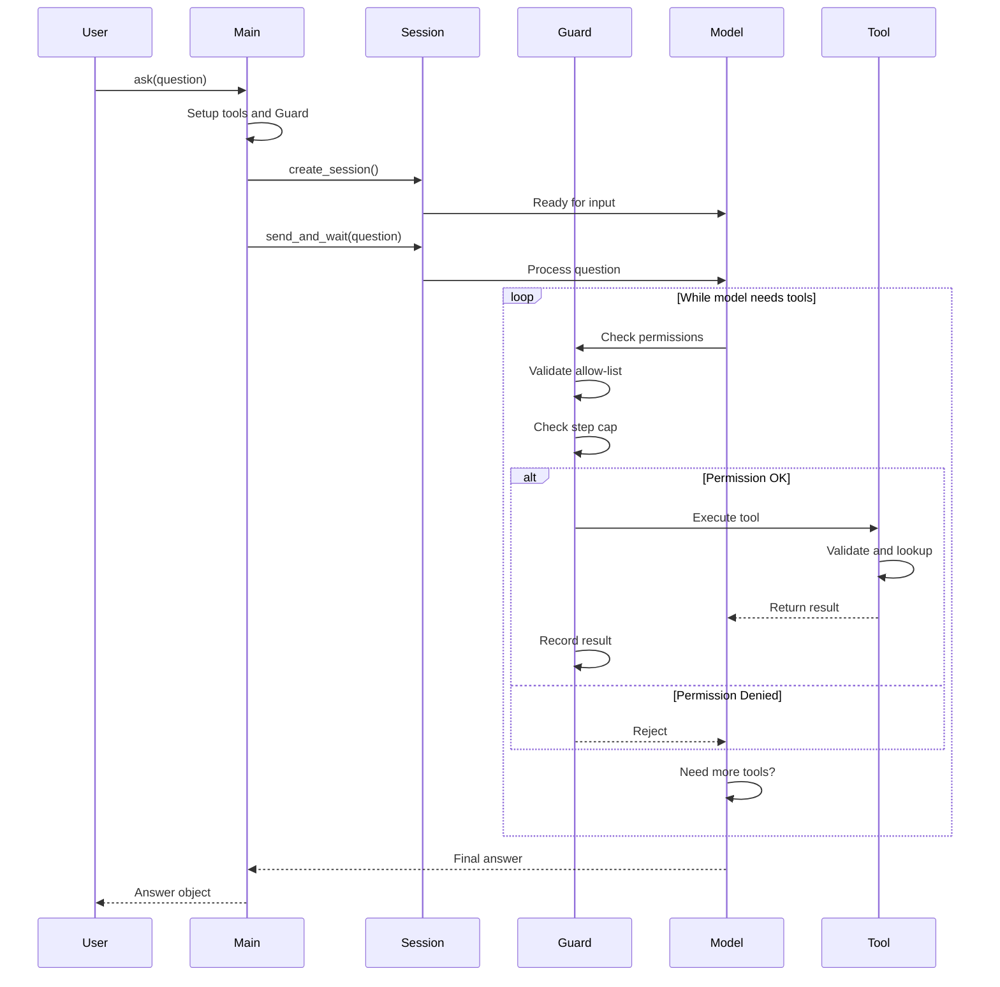

# Module 10: Simple Chat Agent Flow — Comprehensive Guide

## Overview

The **Simple Chat Agent** in `labs/module-10/code-agent` demonstrates the core pattern of building an agentic application using the Copilot SDK. It shows how to:

1. **Initialize** a Copilot client and create a session with controlled tools
2. **Send a question** through the Copilot API
3. **Guard** the agent loop: enforce tool allow-lists, permission checks, and step caps
4. **Retrieve context** via RAG (Retrieval-Augmented Generation) tools
5. **Track usage** and observe tool calls with event hooks

This guide walks through the complete request-response cycle, from user question to final answer.

---

## Quick Start

**Three-step agent loop:**

1. **User asks a question** → `ask(client, question, docs=None)`
2. **Agent chooses tools** → Copilot decides which tools to call
3. **Guard validates** → Allow-list, permission handler, step cap all checked
4. **Tools execute** → `get_build_status()` or `search_docs()`
5. **Answer returned** → Text + trace + usage metrics

---

## Visual Summary: Agent Lifecycle



---

## Architecture: Request-Response Sequence

### Full Agent Loop Sequence Diagram



---

## Core Concepts

### 1. **The `ask()` Function: Entry Point**

```python
async def ask(client, question, docs=None, max_tool_calls=4, timeout=90.0, 
              strategy="section", strict=False):
```

**Purpose:** Execute one agent question-answer cycle.

**Inputs:**
- `client`: CopilotClient instance
- `question`: User's query (string)
- `docs`: Path to docs directory (None = ungrounded; "docs" = with retrieval)
- `max_tool_calls`: Step cap (default 4)
- `timeout`: Session timeout in seconds
- `strategy`: RAG chunking strategy ("section" or other)
- `strict`: Use stronger grounding instructions (Lab 02, step 6)

**Outputs:**
```python
@dataclass
class Answer:
    text: str                # The assistant's final message
    trace: list              # Tool call audit trail
    usage: dict              # Token counts: model_calls, input_tokens, output_tokens
```

---

### 2. **Tool Setup: What the Agent Can Do**

The agent is restricted to **two tools**:

#### **Tool 1: `get_build_status()` — Always Available**

```python
@define_tool(description="Status and failing step for one build...")
async def get_build_status(params: BuildParams) -> str:
    # Validates: build_id matches pattern b-XXXX
    # Returns: {"build_id": "b-1234", "status": "passed"/"failed", 
    #           "failing_step": "unit-tests" or "none"}
```

**Use Case:** Answer "Why did build b-1002 fail?"

---

#### **Tool 2: `search_docs()` — Optional (If `docs` Provided)**

```python
@define_tool(name="search_docs", description="Search the team runbooks...")
async def search_docs(params: SearchParams) -> str:
    # Retrieves top-k passages from RAG index
    # Returns: [{"text": "...", "source": "file.md", "chunk_id": "5"}, ...]
```

**Use Case:** Answer "What is our retention policy?"

**Enabled only if:** `docs` parameter passed to `ask()`

---

### 3. **The Guard: Security & Control**

The `Guard` class enforces **three layers** of control:

#### **Layer 1: Permission Requests** (Before Tool Call)

```python
def on_permission_request(self, request, invocation):
    # Only approve: PermissionRequestCustomTool + tool in allowed set
    if isinstance(request, PermissionRequestCustomTool) and \
       request.tool_name in self.allowed:
        return PermissionDecisionApproveOnce()
    return PermissionDecisionReject(feedback="Not permitted...")
```

---

#### **Layer 2: Pre-Tool Hook** (Before Execution)

```python
async def pre_tool_use(self, hook_input, invocation):
    name, args = hook_input["toolName"], hook_input.get("toolArgs")
    entry = {"tool": name, "args": args, "decision": "allow"}
    
    # Check 1: Allow-list
    if name not in self.allowed:
        entry["decision"] = "deny: not on allow-list"
    
    # Check 2: Step cap
    elif sum(1 for t in self.trace if t["decision"] == "allow") >= self.max_tool_calls:
        entry["decision"] = "deny: step cap"
        self.tripped = True
    
    self.trace.append(entry)
    
    if entry["decision"] != "allow":
        if self.tripped and self.session:
            asyncio.get_running_loop().create_task(self.session.abort())
        return {"permissionDecision": "deny", "permissionDecisionReason": entry["decision"]}
    
    return {"permissionDecision": "allow"}
```

**Decisions:**
- ✅ `allow` → proceed to execution
- ❌ `deny: not on allow-list` → reject tool (model never sees it available)
- ❌ `deny: step cap` → stop agent loop after this tool

---

#### **Layer 3: Post-Tool Hook** (After Execution)**

```python
async def post_tool_use(self, hook_input, invocation):
    for entry in reversed(self.trace):
        if entry["tool"] == hook_input["toolName"] and "result_chars" not in entry:
            entry["result_chars"] = len(str(hook_input.get("toolResult")))
            break
```

Records the result size for audit logging.

---

### 4. **Instrumentation: Event Hooks & Usage Tracking**

The agent observes **one event type** to track tokens:

```python
def on_event(event):
    if getattr(event.type, "value", event.type) == "assistant.usage":
        usage["model_calls"] += 1
        usage["input_tokens"] += event.data.input_tokens or 0
        usage["output_tokens"] += event.data.output_tokens or 0
```

**Why:** Each LLM call (and each tool use) emits a usage event. By counting them, the agent reports:
- Total model API calls
- Cumulative input tokens (prompt)
- Cumulative output tokens (response)

---

### 5. **System Instructions: The Agent's Persona**

Three instruction templates control agent behavior:

#### **BASE (Always)**
```
"You explain build failures for our engineers. Use tools; never guess. 
 Say if unsure. Keep answers to three sentences."
```

---

#### **GROUNDED (If `docs` provided)**
```
" For questions about our procedures, limits, windows or contacts, call search_docs 
  and answer ONLY from its results. Cite the source file and chunk id. 
  If search_docs returns nothing relevant, say you could not find it in the documents."
```

Tells the agent: when uncertain, search first.

---

#### **GROUNDED_STRICT (If `strict=True`)**
```
" You have no knowledge of our services, systems or policies except what search_docs returns. 
  For ANY question about our services, procedures, limits, windows, contacts or retention, ALWAYS call 
  search_docs FIRST, even if you think you know. Answer ONLY from its results and cite the source file and 
  chunk id. If search_docs returns nothing relevant, say you could not find it in the documents. 
  Never ask a clarifying question instead of searching."
```

Mandates: always search, don't guess, don't ask questions.

---

## Step-by-Step: What Happens on `ask(question)`

### **Phase 1: Setup (Synchronous)**

```
1. Build tool list:
   - Always: get_build_status
   - Optionally: search_docs (if docs provided)

2. Build system message:
   - BASE + GROUNDED or GROUNDED_STRICT
   - Combined into single "system" role message

3. Create Guard:
   - Guard(["get_build_status", ...], max_tool_calls=4)
   - guard.trace = []
   - guard.tripped = False
```

---

### **Phase 2: Session Creation (Async)**

```
client.create_session(
    on_permission_request=guard.on_permission_request,  # Layer 1
    tools=[get_build_status, search_docs?],
    available_tools=["get_build_status", ...],          # Hide built-ins
    system_message={"mode": "append", "content": instructions},
    hooks={
        "on_pre_tool_use": guard.pre_tool_use,         # Layer 2
        "on_post_tool_use": guard.post_tool_use,       # Layer 3
    },
    on_event=on_event,                                  # Collect usage
)
```

**Result:** Session opened, ready to send messages.

---

### **Phase 3: Send Question & Wait (Async)**

```
session.send_and_wait(question, timeout=90.0)
```

**Copilot LLM now:**
1. Reads the question
2. Reads the system message (instructions)
3. Reads tool descriptions
4. Decides: "I need these tools"
5. Emits tool calls (or a final message)

---

### **Phase 4: Loop: Tool Calls** (Async)

For **each tool call** the model makes:

```
1. Guard.on_permission_request() 
   → Check: is this tool in the safe set?
   → YES: PermissionDecisionApproveOnce()
   → NO: PermissionDecisionReject()

2. Guard.pre_tool_use()
   → Check: tool in allow-list?
   → Check: step count < max_tool_calls?
   → Append to trace with decision
   → Return allow or deny + reason

3. If denied:
   → asyncio.create_task(session.abort())
   → Guard.tripped = True
   → Loop exits on next iteration

4. If allowed:
   → Tool function executes (get_build_status or search_docs)
   → Input validation (regex, bounds, ...)
   → Lookup or retrieval
   → Return result (JSON string)

5. Guard.post_tool_use()
   → Record result size in trace entry

6. on_event() (if assistant.usage)
   → Increment usage counters

7. Model receives tool result
   → Decides: more tools needed? or final answer?
   → Loop continues or exits
```

---

### **Phase 5: Return Answer** (Sync)

```python
if guard.tripped:
    text = f"(stopped: step cap of {max_tool_calls} tool calls reached)"
elif exception:
    text = f"(stopped: {ExceptionType}: {message})"
else:
    text = reply.data.content

return Answer(text, guard.trace, usage)
```

---

## Example Trace: A Real Execution

### **Scenario:**
```
Question: "Why did build b-1002 fail?"
Docs: None (ungrounded)
Max Tool Calls: 4
```

### **Trace Output:**

```python
Answer(
    text="""Build b-1002 failed during unit-tests. Two tests failed:
             1. test_soft_delete_hides_task: expected deleted_at to be set
             2. test_list_excludes_deleted: 1 deleted task was returned
             
             The soft-delete feature isn't properly hiding deleted tasks.""",
    
    trace=[
        {
            "tool": "get_build_status",
            "args": {"build_id": "b-1002"},
            "decision": "allow",
            "result_chars": 127
        }
    ],
    
    usage={
        "model_calls": 1,
        "input_tokens": 342,
        "output_tokens": 89
    }
)
```

**Analysis:**
- ✅ 1 tool call (within step cap of 4)
- ✅ 1 model call (question → tool call → tool result → final message)
- ✅ 431 total tokens consumed
- ✅ Trace shows exactly what happened

---

## Configuration Options

### **Ungrounded vs. Grounded**

```python
# Lab 01: Ungrounded (no docs, no search)
answer = await ask(client, "Why did b-1002 fail?", docs=None)

# Lab 02: Grounded (with search, soft grounding)
answer = await ask(client, "What's our retention policy?", docs="docs", strict=False)

# Lab 02 Step 6: Grounded Strict (mandatory search, no guessing)
answer = await ask(client, "What's our retention policy?", docs="docs", strict=True)
```

---

### **Tool Step Caps**

```python
# Default: max 4 tool calls
answer = await ask(client, question, max_tool_calls=4)

# Strict: max 1 call (simple lookups only)
answer = await ask(client, question, max_tool_calls=1)

# Permissive: max 10 calls (complex research)
answer = await ask(client, question, max_tool_calls=10)
```

---

### **Model Selection**

```python
# Default: gpt-5-mini
os.environ["LAB_MODEL"] = "gpt-5-mini"

# Custom provider (offline lab)
os.environ["LAB_PROVIDER_URL"] = "http://localhost:8000/v1"
```

---

## Data Flow Diagram

```
┌──────────────────────────────────────────────────────────────┐
│                    USER QUESTION                            │
│                  "Why did b-1002 fail?"                      │
└────────────────────────────┬─────────────────────────────────┘
                             │
                             ▼
                    ┌────────────────┐
                    │   ask()        │
                    │  - tools       │
                    │  - guards      │
                    │  - hooks       │
                    └────────┬───────┘
                             │
                             ▼
        ┌────────────────────────────────────────┐
        │   Copilot Session                      │
        │   ┌──────────────────────────────────┐ │
        │   │ Model Decision Point             │ │
        │   │ Q: "Need tools?"                 │ │
        │   │ A: "Yes, call get_build_status"  │ │
        │   └──────────────────────────────────┘ │
        └────────────────────────────────────────┘
                             │
                ┌────────────┼────────────┐
                │            │            │
                ▼            ▼            ▼
        ┌──────────────┐ ┌────────────┐ ┌────────────────┐
        │ Permission   │ │ Pre-Tool   │ │ Tool Execute   │
        │ Request      │ │ Hook       │ │ - Validate     │
        │ - Tool name  │ │ - Check    │ │ - Lookup       │
        │ - Approve?   │ │   allow-   │ │ - Return JSON  │
        │              │ │   list     │ │                │
        │              │ │ - Check    │ └────────────────┘
        │              │ │   step cap │         │
        │              │ │            │         ▼
        │              │ │ decision   │   ┌───────────────┐
        │              │ │ in trace   │   │ Post-Tool     │
        │              │ │            │   │ Hook          │
        │              │ └────────────┘   │ - Record size │
        │              │                  └───────────────┘
        │              │                         │
        └──────────────┼─────────────────────────┘
                       │
                       ▼
        ┌──────────────────────────────────────┐
        │ on_event(assistant.usage)            │
        │ - model_calls++                      │
        │ - input_tokens +=                    │
        │ - output_tokens +=                   │
        └──────────────────────────────────────┘
                       │
                       ▼
        ┌──────────────────────────────────────┐
        │ Model Decides: More Tools?           │
        │ YES: Loop again                      │
        │ NO: Return final message             │
        └──────────────────────────────────────┘
                       │
                       ▼
        ┌──────────────────────────────────────┐
        │   Answer Object                      │
        │   - text: "Build failed because..."  │
        │   - trace: [tool calls]              │
        │   - usage: {model_calls, tokens}     │
        └──────────────────────────────────────┘
                       │
                       ▼
                  RETURN TO USER
```

---

## Key Design Patterns

### **Pattern 1: Layered Security**

```
Permission Request Layer    ← Application approves tool
         ↓
Pre-Tool Use Hook          ← Guard enforces allow-list & step cap
         ↓
Tool Execution             ← Tool implementation validates inputs
         ↓
Post-Tool Use Hook         ← Guard records result size
         ↓
Event Hook                 ← Track token usage
```

Each layer is independent and can reject/stop the flow.

---

### **Pattern 2: Read-Only Constraints**

All tools use `@define_tool(..., skip_permission=False)`:
- No write operations (get_build_status, search_docs are lookups only)
- JSON responses only (parseable, safe)
- Input validation in every tool (regex, min/max bounds)

Result: **Model cannot harm the system**, even with a jailbreak prompt.

---

### **Pattern 3: Trace-Driven Audit**

Every tool call appends to `guard.trace`:
```python
{
    "tool": "get_build_status",
    "args": {"build_id": "b-1002"},
    "decision": "allow" / "deny: ...",
    "result_chars": 127
}
```

**Benefits:**
- Detect permission violations (denied calls)
- Count steps for step cap
- Audit what the agent did
- No log files or external tracking needed

---

### **Pattern 4: Timeout as Kill Switch**

```python
try:
    reply = await session.send_and_wait(question, timeout=timeout)
except Exception as exc:
    text = f"(stopped: {type(exc).__name__}: {exc})"
```

If the model loops infinitely or takes too long:
- Timeout fires
- Exception caught
- Session cleaned up
- User gets explanation ("stopped: TimeoutError: ...")

---

### **Pattern 5: Flexible Tool Composition**

```python
tools = [get_build_status]  # Always

if docs:
    tools.append(make_search_tool(Index.build(docs)))  # Optionally

guard = Guard([t.name for t in tools], max_tool_calls=max_tool_calls)
```

Same code path for:
- **Lab 01:** Ungrounded (`tools = [get_build_status]`)
- **Lab 02:** Grounded (`tools = [get_build_status, search_docs]`)

No branching, no separate functions.

---

## References

### Official Documentation
- **[Pydantic Field Validation](https://docs.pydantic.dev/latest/)** — Input type safety (BuildParams, SearchParams)
- **[asyncio.create_task()](https://docs.python.org/3/library/asyncio-task.html#asyncio.create_task)** — Non-blocking abort

### Unverified — Check Before Relying On These

- **Copilot SDK Python Docs** — Client, session, tools, events (check your organization's internal documentation or SDK repository)

### Course Materials
- **Module 10 Slides** — Code agents, RAG, guardrails
- **[Lab 01](../labs/module-10/lab-01-simple-grounded-chat-agent.md)** — Ungrounded agent, get_build_status
- **[Lab 02](../labs/module-10/lab-02-rag-retrieval-augmented-generation.md)** — Search_docs, RAG index, strict grounding

### Related Code
- **[agent/agent.py](../labs/module-10/code-agent/agent/agent.py)** — Main `ask()` function
- **[agent/guards.py](../labs/module-10/code-agent/agent/guards.py)** — Guard implementation
- **[agent/tools.py](../labs/module-10/code-agent/agent/tools.py)** — Tool definitions (get_build_status, search_docs)
- **[agent/rag.py](../labs/module-10/code-agent/agent/rag.py)** — RAG Index, embeddings, search

### Concepts to Explore
- **RAG (Retrieval-Augmented Generation)** — Grounding LLMs with documents
- **Tool Use (Function Calling)** — How models decide to use external tools
- **Guardrails & Governance** — Safety constraints, permission systems, audit trails
- **Token Counting** — Observability and cost tracking in LLM apps
