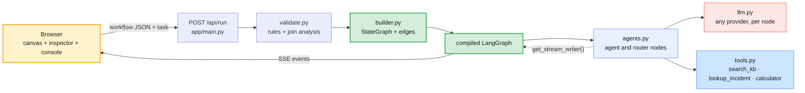

# Multi-Agent Workflow Canvas

**Draw a LangGraph multi-agent workflow, configure each agent, run it, and watch it work.** The browser is a visual editor: you place agents and routers on a canvas, wire them together, and choose each one's instructions, provider, model and tools. Press **Run** and every node lights up as it starts, streams its answer, calls its tools, and hands over, with time and tokens counted as it goes. The server compiles your drawing into a real LangGraph `StateGraph`, and the **Code** tab shows you that graph written by hand.

It is the companion to the Module 2 and Module 3 chatbot demos (`chatbot-web`, `chatbot-web-rag`, `chatbot-web-rag-upload`): the same FastAPI + Server-Sent Events shape, the same single-file page with no build step, the same four providers, now with several agents instead of one.

> Companion to the **Module 4 guide** (`guides/module-04-multi-agent-orchestration-langgraph-patterns-mcp.md`): §2.2 (LangGraph is a state machine), §4.1 (Topologies), §4.2 (A supervisor with specialists), §4.5 (How multi-agent systems fail). Lab 02 builds the supervisor in a notebook; this demo lets you design it by drawing.

---

## What you'll see

| You do | LangGraph does |
| ------ | -------------- |
| Drag an agent onto the canvas and write its role | `graph.add_node(name, agent)` |
| Draw an edge from one agent to another | `graph.add_edge(a, b)` |
| Draw two edges out of one agent | **parallel branches**: both run in the same superstep |
| Draw several edges into one agent | a **join**: it waits for all of them, or runs on the first, as the Checks panel explains |
| Make a node a **router** and label its outgoing edges | the node returns `Command(goto=…)` to pick exactly one route |
| Loop an edge back through a router | a **cycle** with a way out; the step limit is the safety net |
| Press Run | `graph.astream(…, stream_mode=["custom", "values"])`: each node writes progress events, the page draws them |

Also on the page:

- **Four templates**: Sequential pipeline, Parallel analysts, Supervisor and specialists, Writer and critic loop. Each is a worked example of the workflow format.
- **Per-agent settings**: name, instructions, **provider** (OpenAI, Claude, Azure OpenAI or Claude on Foundry, whichever you have configured), **model tier** (main or small), answer length, what it **sees**, and optional **tools** (`search_kb`, `lookup_incident`, `calculator`).
- **Live checks** beside the canvas: a loop with no router, a node nothing leads to, a provider with no key. **Run** stays disabled until they pass.
- **Progress tracking**: a glowing node with a live timer, animated edges, a step trail, a progress bar, streamed output per step, tool calls, the router's reason for every decision, then the final answer, tokens and time.
- **Code and Mermaid tabs**: the LangGraph code and the compiled graph for whatever is on the canvas, with a Copy button.
- **Zoom/Fit, Tidy, Import/Export** (JSON), autosave in the browser, and a draggable divider between canvas and console.
- **Stop**: closing the stream cancels the running nodes on the server, so nothing more is spent.

> The incidents (`INC-…`) and knowledge-base articles (`KB-…`) are the course's synthetic IT-operations data, copied from `labs/module-04/data`. None of it is real.

## How it works



The drawing is **data, not code**. `app/schemas.py` defines it: nodes (`agent` or `router`, with a prompt and a few switches) and edges, plus the two fixed terminals `start` and `end`. The server never runs anything from it except through the fixed node functions and a fixed list of tools, so a shared or imported workflow cannot execute code.

- `app/validate.py` checks the drawing before anything is paid for, and works out each join. A node with several incoming edges **waits for all** of them only when every branch is certain to run; inside a loop, or below a router, it runs **on the first arrival**, because waiting for a branch a router skipped would never end.
- `app/builder.py` turns the checked drawing into `StateGraph` calls. The shared state has three reducers: `outputs` (the latest answer per node), `log` (the order nodes finished) and `steps` (how many have run).
- `app/agents.py` holds the two kinds of node. An **agent** builds its prompt (its role, the task, the work of the agents wired into it or of everyone so far, and its own previous answer so a loop can revise it), streams the reply, and runs a short tool loop if it has tools. A **router** asks the model for a structured route (`next`, `reason`, `instruction`) whose `next` can only be one of its own outgoing edges, then returns `Command(goto=…)`.
- Progress is `get_stream_writer()`: each node writes `node_started`, `token`, `tool_call`, `tool_result`, `route`, `node_finished` or `node_error`, from however many nodes run in parallel, and `/api/run` forwards them as they arrive.
- `app/codegen.py` writes the equivalent hand-written LangGraph for the **Code** tab from the same edge plan the builder uses. A test runs that generated code against a stub model and checks it compiles to the same graph, so the tab cannot drift into fiction.

**The step limit.** A loop needs a way out. Every workflow has a **Step limit**; a router that can no longer fit another agent *and* a closing step ends the run instead of paying for another decision. The run is then marked "stopped at the step limit" and still returns the best answer so far. Workflows without a router cannot loop, so the limit does not apply to them (guide §4.5: ping-pong and runaway loops are the usual multi-agent failures).

## The templates

| Template | Pattern | What to watch |
| -------- | ------- | ------------- |
| **Sequential pipeline** | Pipeline | Researcher (with tools) → Writer → Reviewer. Each agent is handed only the work of the one before it |
| **Parallel analysts** | Fan-out and join | Network, Identity and Knowledge analysts start together; the Synthesiser waits for all three |
| **Supervisor and specialists** | Supervisor (guide §4.2) | The router picks a specialist, the specialist returns to it, and it finishes with the Writer. Click the router's edges to read the routing guidance |
| **Writer and critic loop** | Reflection | The critic holds a checklist the writer has not seen, and sends the draft back until it passes. Lower the step limit to 4 to see it stop |

Representative runs (`gpt-5-mini`, and `gpt-6-luna` for the small tier; one run each, a sample, not a benchmark: the loop's length is the critic's choice, so it varies):

| Template | Steps | Time | Tokens |
| -------- | ----- | ---- | ------ |
| Sequential pipeline | 3 | 34 s | 3.8k |
| Parallel analysts | 4 | 28 s | 6.1k |
| Supervisor and specialists | 6 | 41 s | 6.3k |
| Writer and critic loop | 6 (three drafts) | 34 s | 4.2k |

## Prerequisites

- Python 3.12+
- [`uv`](https://docs.astral.sh/uv/getting-started/installation/) package manager
- An API key for at least one of the four providers below. To compare two vendors in one workflow, configure two.

## Setup

```bash
# from labs/module-04/demos/multiagent-web/

uv sync

cp .env.example .env
# Edit .env — set LLM_PROVIDER and the variables for each provider you want on the canvas
```

| Provider | Calls | Variables to set |
| --- | --- | --- |
| `openai` (default) | OpenAI API | `OPENAI_API_KEY`, `OPENAI_MODEL` |
| `anthropic` | Claude API | `ANTHROPIC_API_KEY`, `ANTHROPIC_MODEL` |
| `azure-openai` | Azure OpenAI | `AZURE_OPENAI_API_KEY`, `AZURE_OPENAI_ENDPOINT`, `AZURE_OPENAI_DEPLOYMENT` |
| `azure-anthropic` | Claude on Microsoft Foundry | `ANTHROPIC_FOUNDRY_API_KEY`, `ANTHROPIC_FOUNDRY_RESOURCE`, `ANTHROPIC_FOUNDRY_DEPLOYMENT` |

`LLM_PROVIDER` is the **default**: an agent whose Provider is left on "Default" uses it. Each agent may pick any other provider that has its variables set; the dropdown greys out the rest. Each provider also has an optional **small model** (`OPENAI_SMALL_MODEL`, `ANTHROPIC_SMALL_MODEL`, `AZURE_OPENAI_SMALL_DEPLOYMENT`, `ANTHROPIC_FOUNDRY_SMALL_DEPLOYMENT`) that an agent can choose to answer faster and cheaper; without it the small tier uses the main model. Routers default to the small tier, as in Lab 02: a router only classifies.

The names match the course's repo-root `.env` (`labs/setup/.env.example`). Without a local `.env`, `load_dotenv()` picks up that file. On Azure the model is the **deployment name** you created, not the base model name.

`OPENAI_REASONING_EFFORT` (optional) applies to OpenAI reasoning models only: a low value shortens the wait before the first token, which matters when five agents run in a row.

> Never commit `.env`. It is already in `.gitignore`. No endpoint ever returns a key, and error messages are scrubbed of key-like text.

## Run

```bash
uv run uvicorn app.main:app --reload --port 8000
```

Open <http://localhost:8000>. The top bar shows the default provider and model.

## Try it (the 5-minute demo)

1. **Run a pipeline.** The Sequential template is loaded with its task. Press **▶ Run workflow**. The Researcher glows, its tool calls appear in the console, the edge to the Writer animates, and each finished node turns green with its time. The **Output** tab opens with the answer.
2. **Read the code.** Open the **Code** tab: this canvas is those `add_node` and `add_edge` calls. The **Mermaid** tab is LangGraph's own drawing of the same graph.
3. **Go parallel.** Pick **Parallel analysts** and run it. Three nodes glow at once; the Synthesiser waits. Open the **Checks** panel's join line: "Synthesiser waits for all its inputs".
4. **Add a decision.** Pick **Supervisor and specialists**. Watch the router's reason for each route in the console. Click one of its edges and edit the guidance text; run again and the routing can change.
5. **Loop and stop.** Pick **Writer and critic loop**. Watch the draft come back with the critic's feedback ("ran 3×" on the nodes). Open the Workflow panel (click empty canvas), set **Step limit** to 4, and run again: if the critic asks for a second draft, the run ends at the limit and still returns the last one.
6. **Build your own.** **New**, then **＋ Agent** three times. Drag from the dot on a node's right edge to the next node to connect them, Start to first, last to End. Give each a role, turn on `search_kb` for one, set another to **Claude**, and run. Delete the edge to End and read the Checks panel.

## Project layout

```
multiagent-web/
├── .env.example               # Provider settings template
├── pyproject.toml             # fastapi, langgraph, langchain, openai, anthropic (pinned to labs/setup/requirements.txt)
├── data/                      # synthetic KB articles and incidents for the tools (copied from labs/module-04/data)
├── app/
│   ├── main.py                # FastAPI: config, templates, validate, and the streaming /api/run
│   ├── schemas.py             # the workflow format: nodes, edges, limits
│   ├── validate.py            # the rules, loops, and join analysis
│   ├── builder.py             # workflow → compiled StateGraph (state, reducers, edge plan)
│   ├── agents.py              # the agent node (tool loop) and the router node (structured route)
│   ├── llm.py                 # LangChain chat models for the four providers, chosen per node
│   ├── tools.py               # search_kb, lookup_incident, calculator
│   ├── templates.py           # the four ready-made workflows
│   ├── codegen.py             # workflow → the equivalent hand-written LangGraph
│   └── guardrails.py          # input check on the task (block and redact)
├── tests/
│   ├── conftest.py            # a scripted stand-in for the chat model
│   ├── test_workflow.py       # rules, joins, tools, guardrail, providers, the generated code
│   └── test_api.py            # the four patterns end to end, the step limit, failures
└── static/
    └── index.html             # the editor: SVG canvas, inspector, progress console (no build step, no CDN)
```

## API Reference

| method & path | purpose |
| ------------- | ------- |
| `GET /api/config` | providers and their models, the tool list, answer lengths, limits (never a key) |
| `GET /api/templates` | the four ready-made workflows, each with a sample task |
| `POST /api/validate` | problems and warnings, each join's behaviour, and (when sound) the Mermaid text and the LangGraph code |
| `POST /api/run` | run `{workflow, task}` and stream progress (SSE). Invalid workflows are refused with HTTP 400 and the problems listed |
| `GET /healthz` | liveness, the default provider, and which providers are configured |

`POST /api/run` streams `data: {json}` events, each with an `event` field:

| event | meaning |
| ----- | ------- |
| `run_started` | the run id, the step limit, the task as the agents will see it (after redaction) |
| `node_started` | a node begins: its provider, model and step number |
| `token` | a piece of the answer, as the model writes it |
| `tool_call` / `tool_result` | an agent asked for a tool, and what came back |
| `route` | a router chose where to go: the target, its reason and its instruction (`forced: true` at the step limit) |
| `node_finished` | the node's whole output, its time and its token counts |
| `node_error` / `error` | a node failed / the run stopped |
| `guardrail` | the task was blocked before any agent ran |
| `run_finished` | `completed`, `limit` or `blocked`, the final answer(s), the path taken, steps, tokens and time |

## Test

```bash
uv run pytest
```

101 offline tests, no API key and no network: the model is replaced by a scripted stand-in, so what is tested is your workflow logic, not a model's mood. They cover every validation rule, join behaviour, the tools (including that the calculator parses arithmetic and never executes anything else), the guardrail, error text that never repeats a key, the four patterns run end to end with their event order, a loop that never converges and the step limit that ends it, tool calls, per-node providers, failures, and that the Code tab's output compiles to the same graph as the builder.

## Troubleshooting

**The Run button is greyed out** — the **Checks** panel (top of the right column) lists why: a node with no outgoing edge, a loop with no router, a provider that is not configured in `.env`. Fix the first one and the rest often disappear.

**`LLM provider error 401: the API key or permission was rejected`** — the key for that agent's provider is wrong. Set it in `.env` and restart the server.

**`... not found in environment variables!`** — a variable is missing for a provider an agent uses. Add it to `.env`, or set that agent's Provider to one that is configured.

**The run is slow** — reasoning models think before the first token, and a workflow of five agents waits five times. Pick the **Small** model tier for simple agents, set `OPENAI_REASONING_EFFORT` to a low value, or give agents a **Short** answer length.

**A router ends the run straight away** — the step limit is too low for the path you drew. It needs room for each agent *and* a closing step: raise it on the Workflow panel (click empty canvas).

**A loop runs more times than you expected** — the router decides when to stop, from the text you wrote on its edges. Make the criterion specific ("the draft states the UTC window"), or lower the step limit.

**The canvas is empty after a restart** — the page autosaves in your browser. **New** clears it, and importing a file or picking a template replaces it. Use **Export** to keep a workflow.

**`Could not reach the server`** — start it from inside `multiagent-web/` with `uv run uvicorn app.main:app --port 8000`.

**`ModuleNotFoundError: app`** — run from inside `multiagent-web/`, not from its parent.

**`ModuleNotFoundError`** after copying the project — the `.venv` came along and its scripts still point at the old folder. Delete `.venv` and run `uv sync`.

## Limits worth knowing

- A router takes **exactly one** route. To run agents in parallel, draw two edges out of an agent, not out of a router.
- Parallel branches of **different lengths** that merge into a node set to "runs on the first arrival" can run that node more than once. Keep merging branches the same length, or merge them below a node that waits for all.
- State is per run, in memory. There is no persistence, checkpointing or authentication: this is a teaching tool for one person on a laptop.
- The tools are local and read-only on purpose: an agent can look things up and do sums, nothing more.

## Beyond This Demo

- **Orchestrator-workers with `Send`** (guide §4.3): let a node decide at run time how many workers to start, instead of drawing them.
- **Human approval** (guide §5.3): pause a node with `interrupt()` and resume it from the page, with a checkpointer behind the run.
- **Tools over MCP** (guide §6): replace the three local tools with an MCP server and let agents pick from what it advertises.
- **Tracing** (Module 5): send each run to LangSmith or Langfuse, so a slow node or a bad route is a click away.
- **Evaluate a workflow**: keep a set of tasks with expected routes, run them against a saved workflow, and compare two drawings the way Lab 02 compares two prompts.
- **Save workflows on the server**: a small store and a list view turn the editor into a shared library of patterns.
